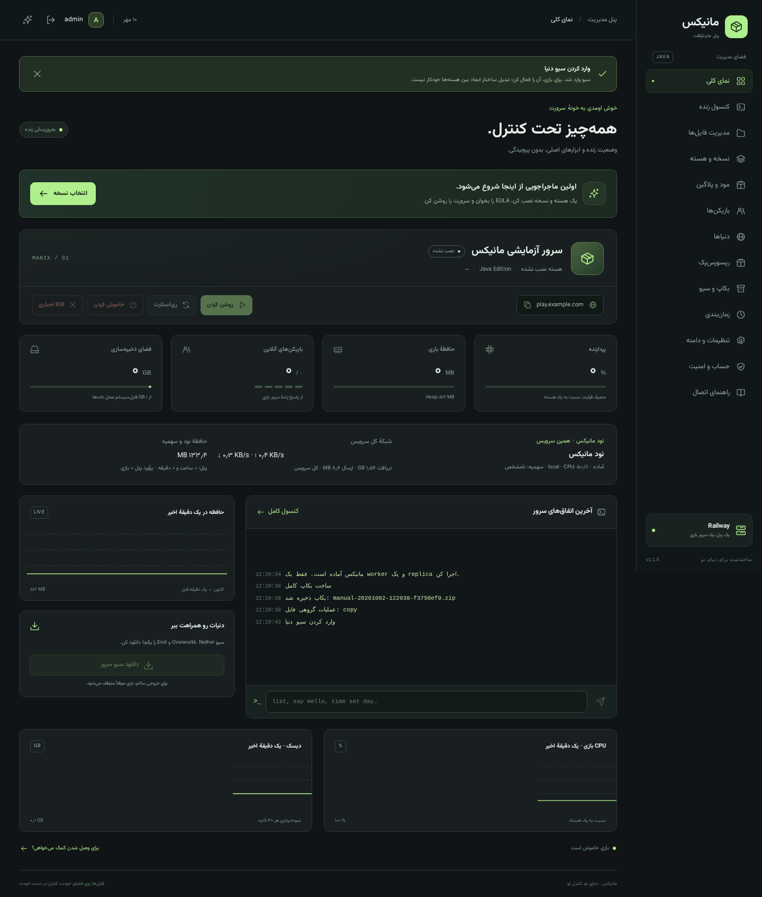

<div dir="rtl">

# 🟩 مانیکس — Manix Railway

### پنل فارسی و سرور واقعی Minecraft Java، داخل **یک سرویس Railway**

**نسخهٔ 1.1.0** · یک مالک · یک سرور بازی · رابط فارسی RTL · حالت تاریک/روشن · داده‌های دائمی روی Volume

مانیکس خودش فرایند Java سرور Minecraft را در همان کانتینری اجرا می‌کند که پنل وب در آن است؛ به VPS جدا نیاز ندارد. خاموش کردن بازی، پنل را خاموش نمی‌کند.

> **حدود پروژه:** مانیکس VPS کامل، فروشگاه هاست، سامانهٔ چندکاربرهٔ ایزوله یا پنل مدیریت چند نود نیست. ثبت‌نام عمومی، پرداخت، تمدید پلن، ساخت MySQL/MariaDB و تخصیص خودکار پورت عمومی پیاده نشده‌اند. امکانات ناممکن در این معماری با دکمهٔ نمایشی جایگزین نشده‌اند. Railway، منابع، Volume، TCP Proxy، دامنه و هزینهٔ حساب خودت را باید تنظیم کنی.



تصویرها از رابط متصل به بک‌اند تست گرفته شده‌اند؛ نام، سیو و آدرس نمونه‌اند، نه مدرک استقرار Railway یا بازی با بازیکن واقعی. [حالت روشن](docs/screenshots/dashboard-light.png) · [موبایل](docs/screenshots/mobile.png) · [زمان‌بندی](docs/screenshots/schedules.png)

## از کجا شروع کنم؟

1. [نصب GitHub → Railway](#نصب-github--railway)
2. [اولین روشن‌کردن بازی](#اولین-روشنکردن-بازی)
3. [مود، پلاگین و نسخه](#هسته-java-مود-و-پلاگین)
4. [دنیا، فایل‌ها و بکاپ](#دنیاها-و-فایلها)
5. [دامنه و پورت](#دامنه-و-پورت)
6. [حساب، رمز، ۲FA و API Key](#حساب-رمز-۲fa-و-api-key)
7. [زمان‌بندی](#زمانبندی)
8. [پوشش تک‌تک ویژگی‌های درخواستی](docs/FEATURES.md)
9. [API و محدودیت‌ها](docs/API.md) · [امنیت](SECURITY.md) · [عیب‌یابی](docs/TROUBLESHOOTING.md) · [گزارش تست](docs/TESTING.md)

راهنمای خیلی کوتاه هم در `START-HERE.txt` است.

---

## چه چیزهایی واقعاً آماده است؟

امکانات قبلی دوباره پیاده‌سازی نشده‌اند؛ افزونه‌های این نسخه از همان فایل‌منیجر، کنترل فرایند، صف Job و بکاپ استفاده می‌کنند.

| بخش | امکانات واقعی |
|---|---|
| داشبورد | وضعیت بازی، بازیکنان، RSS و CPU فرایند Java، دیسک فایل‌سیستم، Uptime، نسخهٔ MC/Java، آدرس اتصال؛ نمودار RAM/CPU/Disk |
| نود و شبکه | سلامت **همین سرویس**، سهمیهٔ CPU در صورت وجود cgroup، CPU و حافظهٔ سرویس، نرخ و مجموع ترافیک شبکهٔ کانتینر |
| قدرت | Start، Stop با ذخیره، Restart، **Kill اجباری**، بازیابی وضعیت مطلوب بعد از Redeploy، بازیابی اختیاری پس از Crash |
| کنسول | خروجی زندهٔ بازی/نصاب، یک خط دستور واقعی، پاک‌کردن نمایش، دانلود لاگ چرخشی |
| فایل‌منیجر | ساخت فایل/پوشه، آپلود و Drag & Drop، دانلود، rename، **copy/move، چندانتخابی و حذف گروهی**، جستجو/فیلتر/صفحه‌بندی، ویرایش UTF-8، ZIP/Unzip |
| هسته | نصب رسمی Vanilla / Paper / Purpur / Fabric / Forge / NeoForge؛ **آپلود JAR اجرایی Spigot/سفارشی**؛ حذف runtimeهای قدیمی غیرِفعال |
| Java و اجرا | Java 8/17/21/25 داخل Docker، انتخاب مناسب، تغییر heap و **JVM flags از فهرست مجاز**؛ نمایش فرمان واقعی، نه Shell آزاد |
| مود/پلاگین | Modrinth با نسخه/لودر سازگار و وابستگی Required قابل‌تشخیص؛ JAR دستی، حذف، enable/disable، نسخهٔ افزونه‌های شناخته‌شده، نصب آخرین Release سازگار |
| بازیکن | فهرست `list` کنسول با fallback به نمونهٔ Status، جستجوی فهرست‌ها، ورود مشاهده‌شده، OP/Deop، Kick/Ban/Pardon، Whitelist و روشن/خاموش آن، IP Ban/Unban، دستور با `{player}` |
| دنیا | فهرست، ساخت پوشه برای تولید دنیا، واردکردن ZIP سیو، انتخاب دنیای فعال، ZIP/دانلود تکی، حذف دنیای غیرِفعال با بکاپ قبلی |
| ریسورس‌پک | آپلود ZIP، بررسی `pack.mcmeta`، SHA-1، URL عمومی مخصوص دانلود کلاینت، فعال/غیرفعال/تعویض، required/prompt و حذف |
| بکاپ | کامل از فایل‌های بازی، دستی/خودکار، import/download/delete/restore، Safety قبل از Restore، سازگاری بکاپ نسخهٔ قبلی |
| زمان‌بندی | یک‌باره/روزانه/هفتگی با منطقهٔ زمانی IANA؛ start/stop/restart/backup/command؛ edit/disable/delete و نمایش نتیجه |
| تنظیمات | MOTD، difficulty، gamemode، distances، Max Players، PvP، Online Mode، Whitelist، Spawn Protection و نگهداری کلیدهای پیشرفتهٔ properties |
| حساب | پروفایل مالک، ایمیل تماس، تغییر رمز، نشست‌ها و لغو تکی/همه، TOTP و کد بازیابی یک‌بارمصرف، تاریخچهٔ ورود، Activity Log، کلید API دارای Scope/انقضا |
| رابط | فارسی/RTL، responsive، موبایل/تبلت/دسکتاپ، theme ذخیره‌شونده، Toast و Modal، اعلان وضعیت/Job/کمبود منابع هنگام باز بودن پنل |

**Spigot خودکار ساخته/دانلود نمی‌شود.** برای آن JAR سرورِ اجرایی ساخته‌شده توسط خودت را می‌دهی. **پورت عمومی، DNS و منابع Railway از پنل provision نمی‌شوند.** دیتابیس SQLite داخلی پنل، جای قابلیت ایجاد MySQL/MariaDB نیست. سیستم Permission فعلی مالک واحد + Scope کلید API است، نه حساب Subuser.

جدول دقیق و بدون ابهام برای **همهٔ موارد فایل درخواست‌شده**: [docs/FEATURES.md](docs/FEATURES.md).

---

## نصب GitHub → Railway

### ۱) ZIP را در GitHub قرار بده

1. ZIP را استخراج کن و یک Repository، ترجیحاً Private، بساز.
2. **محتویات پوشهٔ `manix-railway` را در ریشهٔ Repo قرار بده**؛ خود ZIP یا پوشهٔ بیرونی تو‌در‌تو را به‌جای سورس آپلود نکن.
3. در ریشه باید `Dockerfile`، `requirements.txt`، `panel/` و `scripts/` باشند.
4. `.env` واقعی، رمز، توکن، JAR شخصی، دنیا و بکاپ را کامیت نکن. `.env.example` فقط نمونه است.

### ۲) سرویس را بساز

Railway → **New Project → Deploy from GitHub Repo** → Repository خودت.

- Builder باید **Dockerfile** باشد؛ Root Directory ریشهٔ Repo.
- Build/Start Command اضافه لازم نیست. دستور قدیمی ناسازگار را پاک کن؛ Dockerfile و entrypoint را دور نزن.
- **Replicas = 1**؛ فقط یک worker. چند کپی روی یک Volume می‌تواند دنیا را خراب کند.
- **Serverless / App Sleeping خاموش**؛ بازی با ترافیک HTTP پنل زنده نگه داشته نمی‌شود.
- RAM/CPU/Volume کافی تخصیص بده؛ هیچ پلن یا منابع نامحدودی توسط پروژه ایجاد نمی‌شود.

اولین Deploy قبل از تنظیم رمز یا Volume ممکن است عمداً متوقف شود. مراحل بعد را انجام بده و Redeploy کن.

### ۳) Volume دائمی وصل کن

Volume را به **همین سرویس** وصل کن. Mount Path:

```text
/data
```

`DATA_DIR` باید دقیقاً همین Mount Path باشد. Railway باید `RAILWAY_VOLUME_MOUNT_PATH` را در runtime فراهم کند. بدون این تطابق، برنامه fail-closed می‌شود تا دنیا روی دیسک موقت گم نشود. Volume هنگام runtime متصل می‌شود، نه Build/Pre-deploy.

### ۴) Variables ضروری

```dotenv
PANEL_USERNAME=admin
PANEL_PASSWORD=replace-with-a-strong-password
PORT=8080
MC_PORT=25565
DATA_DIR=/data
MC_MEMORY_MB=1024
EULA_ACCEPTED=false
RAILWAY_RUN_UID=0
```

- **PANEL_PASSWORD نمونه را عوض کن؛ مقدار بالا در برنامه رد می‌شود.** حداقل ۱۲ کاراکتر، بهتر است تصادفی و طولانی باشد.
- ساخت رمز روی کامپیوتر خودت:

```bash
python -c "import secrets; print(secrets.token_urlsafe(24))"
```

- `RAILWAY_RUN_UID=0` برای entrypoint اولیه و اصلاح مالکیت Volume است؛ قبل از اجرای پنل/Java با `gosu` به کاربر غیر-root `panel` تغییر می‌کند.
- `EULA_ACCEPTED=false` بماند تا پیش از اولین Start خودت EULA را بخوانی و بپذیری.
- تنظیمات اولیهٔ heap، EULA و پورت بازی در SQLite ذخیره می‌شوند؛ بعد از اولین راه‌اندازی آن‌ها را از پنل تغییر بده. Environment هر Redeploy آن‌ها را بازنویسی نمی‌کند.
- `PANEL_PASSWORD` استثناست: تغییر **واقعی** آن در Environment، رمز ورود را بازنشانی و نشست‌ها/کلیدها را باطل می‌کند. [رفتار تغییر رمز](#حساب-رمز-۲fa-و-api-key) را بخوان.

### ۵) دو ورودی شبکه روی همان سرویس

در Railway → Service → **Settings → Networking**:

| ورودی | مقصد داخل کانتینر |
|---|---|
| HTTP / Generate Domain | `8080` یا مقدار `PORT` |
| TCP Proxy بازی | `25565` یا پورت داخلی ذخیره‌شدهٔ بازی |
| Healthcheck اختیاری | `/healthz` روی پورت HTTP |

`EXPOSE` در Dockerfile به‌تنهایی آدرس عمومی نمی‌سازد.

خروجی بازی شبیه `xxx.proxy.rlwy.net:12345` است. **پورت عمومی Railway لزوماً 25565 نیست.** در مانیکس → تنظیمات و دامنه، Proxy host و **پورت عمومی** را ثبت کن. متغیرهای `RAILWAY_TCP_PROXY_DOMAIN/PORT` فقط مقدار اولیهٔ فرم‌اند؛ اگر Proxy تغییر کرد، فرم را هم اصلاح کن.

### ۶) Redeploy و ورود

بعد از تنظیم Variables، Volume و منابع Redeploy کن. دامنهٔ HTTP پنل را باز کن و با `admin` و **رمز خودت** وارد شو. هیچ رمز پیش‌فرض قابل‌استفاده یا ثبت‌نام عمومی وجود ندارد.

[چک‌لیست دقیق Railway، CLI و ارتقا](docs/RAILWAY.md)

---

## اولین روشن‌کردن بازی

1. «نسخه و هسته» → هسته و Minecraft موردنظرت → نصب.
2. Paper/Purpur برای پلاگین؛ Fabric/Forge/NeoForge برای مود؛ Vanilla بازی اصلی است.
3. در کنسول منتظر پایان Job نصب بمان. Forge/NeoForge نصاب رسمی دارند و ممکن است چند دقیقه طول بکشند.
4. EULA رسمی را **خودت بخوان و تأیید کن**؛ پروژه از طرف تو قبول نمی‌کند.
5. «روشن کردن» را بزن. وضعیت ابتدا starting است؛ منتظر `Done`/پاسخ Status و «روشن» بمان.
6. Minecraft **Java Edition** → Multiplayer → آدرس عمومی TCP Proxy، با پورت خروجی خودت.

Stop دستور `stop` را می‌فرستد، منتظر ذخیره می‌ماند و فقط در صورت timeout به SIGTERM/SIGKILL می‌رسد. **Kill اجباری فوراً SIGKILL می‌فرستد و ممکن است ذخیرهٔ آخرین تغییرات را از بین ببرد**؛ جای Stop معمولی نیست. Stop/Kill دستی، desired-running را خاموش نگه می‌دارند تا Restart خودکار آن را دوباره روشن نکند.

Crash recovery اختیاری است: تأخیر ۱۰ ثانیه و سقف سه تلاش در ده دقیقه. خروجی خطادار را قبل از فعال‌کردن تکرار خودکار بررسی کن.

---

## هسته، Java، مود و پلاگین

### نسخه‌های رسمی

فهرست نسخه‌ها از API رسمی سازنده خوانده می‌شود. فقط releaseهای Minecraft پشتیبانی‌شده؛ Paper فقط بیلد STABLE و NeoForge بدون بیلد بتا در نصب خودکار. نبود STABLE به‌صورت خطا اعلام می‌شود؛ نسخهٔ دیگری پنهانی جایگزین انتخاب تو نمی‌شود.

Java 8/17/21/25 از Temurin در Docker موجود است. حالت Auto بر اساس حداقل Mojang و، برای Paper، حداقل اعلام‌شدهٔ تولیدکننده انتخاب می‌کند. Forge/NeoForge با نصاب/args رسمی نصب می‌شوند. همهٔ ترکیب‌های تاریخی و همهٔ مودپک‌ها تضمین نشده‌اند.

### Spigot و JAR سفارشی

در قسمت JAR دستی، فایل **سرور اجرایی** مورداعتماد، نوع، نسخهٔ واقعی Minecraft و Java را انتخاب کن. ZIP/JAR باید Main-Class و کلاس اصلی واقعی داشته باشد؛ JAR پلاگین یا نصاب معمولی جای سرور نیست.

مانیکس BuildTools/JDK برای ساخت Spigot provision نمی‌کند و از mirror غیررسمی Spigot نمی‌گیرد. JAR را خودت با روش معتبر تولید/تهیه کن. بررسی کلاس اصلی و حداقل Minecraft، سازگاری همهٔ کلاس‌ها/کتابخانه‌های JAR را تضمین نمی‌کند. هستهٔ custom هم سازگاری مود/پلاگین حدسی دریافت نمی‌کند؛ فقط نوع Spigot مسیر پلاگین خودش را می‌شناسد.

### تغییر نسخه و حذف قبلی

بازی باید خاموش باشد. قبل از فعال‌کردن نسخهٔ تازه بکاپ ساخته می‌شود؛ دنیا حذف نمی‌شود و JARهای احتمالاً ناسازگار به `disabled-addons/` می‌روند. Paper↔Purpur روی همان Minecraft، پلاگین‌ها را حفظ می‌کند.

Downgrade جهان ممکن است فرمت آن را خراب کند و تأیید جدا دارد. بکاپ مهم را خارج از Railway نگه دار. از فهرست runtimeها، هستهٔ **غیرِفعال** را می‌توان حذف کرد؛ بکاپ وابسته ممکن است بعداً نصب مجدد همان هسته/نسخه بخواهد. حذف runtime، سیو را حذف نمی‌کند.

### مود/پلاگین

- Modrinth بر اساس MC/loader و server-side جستجو می‌شود؛ وابستگی‌های Required قابل‌تشخیص هم stage و checksum می‌شوند. وابستگی فایل‌محور یا مود صرفاً کلاینتی، خودکار نصب نمی‌شود.
- JAR دستی → «آپلود دستی JAR» → `mods/` یا `plugins/` در فایل‌منیجر.
- Enable/disable با `.jar.disabled` انجام می‌شود؛ بازی باید خاموش باشد.
- برای افزونهٔ شناخته‌شدهٔ Modrinth، «نصب آخرین نسخهٔ سازگار» از همان مسیر نصب استفاده می‌کند و فایل قبلی را پس از دریافت موفق جایگزین می‌کند. این قابلیت اعلان خودکار تمام updateها یا مدیریت افزونهٔ دستی نیست.
- نسخهٔ JAR دستی همیشه قابل‌تشخیص نیست؛ با «دستی» مشخص می‌شود.
- بعضی مودها روی کلاینت بازیکن هم لازم‌اند. نصب سرور، کلاینت‌ها را نصب نمی‌کند.
- CurseForge/modpack پیچیده، دیتابیس یا وابستگی سیستم‌عامل خودکار مدیریت نمی‌شود.
- **هر JAR کد اجرایی است و با همان UID پنل به فایل‌ها/Environment دسترسی بالقوه دارد؛ فقط کد مورداعتماد نصب کن.**

---

## دنیاها و فایل‌ها

### دنیاهای مانیکس

- «دنیای تازه» فقط پوشه می‌سازد؛ **فعال کن و Start بزن تا خود Minecraft دنیا را تولید کند**. پیش‌تولید Chunk/تعویض فرمت خودکار نیست.
- World ZIP: `level.dat` در ریشه یا دقیقاً یک پوشهٔ دنیای اصلی دارای `level.dat`؛ ابعاد Paper با نام‌های کنار آن (`_nether`/`_the_end`) هم با نام تازه وارد می‌شوند.
- نام مقصد باید تازه باشد؛ فایل موجود بی‌خبر جایگزین نمی‌شود. ZIP بکاپ کامل از بخش بکاپ Restore می‌شود، نه World import.
- اگر ZIP چند دنیای اصلی دارد یا ساختار پیچیده است، از فایل‌منیجر Extract استفاده کن و ساختار را خودت بررسی کن.
- «فعال کردن» مقدار `level-name` را عوض می‌کند؛ بازی باید خاموش باشد.
- دانلود تکی دنیا/ابعاد همراهش یا خروجی همهٔ دنیاها از بخش بکاپ. برای بازی روشن، توقف/راه‌اندازی موقت جهت خروجی سالم انجام می‌شود.
- دنیای فعال از صفحهٔ World حذف نمی‌شود. قبل از حذف دنیای غیرِفعال بکاپ کامل ساخته می‌شود.

مانیکس ساختار ZIP و وجود `level.dat` را بررسی می‌کند، **نه سلامت کامل NBT یا سازگاری save با هر MC**. تبدیل ساختار Nether/End بین Vanilla و Paper، repair دنیا و تبدیل version توسط پنل انجام نمی‌شود.

### فایل‌منیجر

فقط `/data/server` قابل‌دسترسی است؛ نه `/data/panel` یا runtimeها. مسیر باید نسبی و بدون `..`/symlink باشد. برای تغییر فایل‌ها، بازی خاموش و Job دیگری تمام شده باشد.

- create/mkdir/rename/upload/download؛ متن UTF-8 تا ۱ MB، Ctrl/Cmd+S.
- search نام فایل در پوشه یا زیرپوشه؛ فیلتر فایل/پوشه و ۵۰ مورد در هر صفحه. جستجوی recursive تا ۲۰٬۰۰۰ ورودی/۱٬۰۰۰ نتیجه محدود است؛ به جستجوی محتوا تبدیل نمی‌شود.
- Checkboxها برای copy/move/bulk delete؛ حداکثر ۲۰۰ مسیر. انتخاب با تغییر پوشه/جستجو پاک می‌شود؛ برای یک مورد همان یک Checkbox کافی است.
- مقصد copy/move باید پوشهٔ موجود باشد؛ فایل هم‌نام بازنویسی نمی‌شود و کپی پوشه به داخل خودش ممنوع است. کپی پوشهٔ دارای symlink رد می‌شود.
- **حذف گروهی** بکاپ قبلی دارد. حذف تکی معمولی از فایل‌منیجر به‌خودی‌خود بکاپ کامل نمی‌سازد؛ قبل از حذف مهم خودت بکاپ بگیر.
- Extract ZIP قبل از بازنویسی بکاپ می‌گیرد. ZIP رمزدار، symlink، traversal، تعداد/حجم نامجاز رد می‌شوند.
- پوشه را ZIP/دانلود کن؛ برای سیو بازی روشن از Export دنیا استفاده کن، نه دانلود تک‌تک فایل در حال تغییر.

copy/move به staging/rollback خطای حین اجرا مجهزند، اما تراکنش ضد قطع برق/Crash برای تک‌تک فایل‌ها تضمین نیست. قبل از Redeploy، منتظر پایان Job بمان.

---

## ریسورس‌پک

1. بازی خاموش → «ریسورس‌پک» → ZIP با `pack.mcmeta` معتبر **در ریشه** آپلود کن.
2. پک و آدرس **HTTPS عمومی همین پنل**، مثلاً `https://panel.example.com`، را انتخاب کن.
3. required و prompt اختیاری را تنظیم و فعال کن.
4. از Start بعدی، `resource-pack`، SHA-1 و شناسه در `server.properties` اعمال می‌شود.

کلاینت Minecraft cookie پنل ندارد. به همین علت فایل از مسیر دارای شناسهٔ تصادفی `/packs/<id>.zip` **بدون ورود** دریافت می‌شود. کسی که URL را دارد می‌تواند ZIP را دانلود کند؛ **پک محل فایل خصوصی نیست**. فهرست و مدیریت آن همچنان احراز هویت می‌خواهد.

ZIP، SHA-1 و index داخل `server/resourcepacks/` هستند و در بکاپ کامل بازی می‌آیند. پک فعال را ابتدا غیرفعال/تعویض کن تا حذف مجاز شود. بعد از انتقال به دامنه/Volume تازه، URL پایه را دوباره فعال‌سازی کن؛ URL قدیمی خودبه‌خود تغییر نمی‌کند. سازگاری فرمت/نسخه و دانلود واقعی کلاینت را روی Minecraft خودت تست کن. این استقرار دریافت فایل نیازمند HTTPS عمومی است.

---

## بکاپ و بازیابی

- بکاپ کامل: فایل‌های بازی، دنیا، مود/پلاگین/تنظیمات و ریسورس‌پک؛ **نه دیتابیس ورود پنل، رمز/TOTP/API Key، Taskها یا runtime/Java**.
- بازی روشن برای بکاپ سازگار موقتاً Stop و بعد از پایان Start می‌شود؛ بازیکن‌ها قطع می‌شوند.
- manual، automatic، download، import، delete و Restore واقعی.
- Restore فقط بازی خاموش؛ قبلش Safety ساخته می‌شود و journal برای بازیابی عملیات قطع‌شده وجود دارد.
- روی Volume تازه ابتدا **همان هسته و نسخه** را نصب کن؛ ZIP بکاپ را import و Restore کن. روی Volume قبلی، runtime matching اگر موجود باشد انتخاب می‌شود.
- بکاپ فرمت نسخهٔ قبلی هم قابل‌واردکردن و Restore است؛ فایل‌های تازه با نام/متادیتای مانیکس ساخته می‌شوند.
- فقط `auto-*.zip` با `backup_keep` پاک‌سازی می‌شود. بکاپ‌های زمان‌بندی تقویمی هم خودکارند. manual، safety و before-* خودکار purge نمی‌شوند.
- Export دنیا/پوشه موقت است و بعد از حدود یک روز، هنگام ساخت خروجی‌های بعدی، ممکن است پاک شود؛ دانلودش کن.
- تنظیمات مود/پلاگین ممکن است کلید خصوصی خودت داشته باشند؛ بکاپ را عمومی نکن.

**بکاپ روی همان Volume، off-site نیست. پاک کردن Volume، همهٔ آن‌ها را پاک می‌کند.** از فایل مهم خارج از Railway نسخه داشته باش؛ بکاپ provider هم در صورت امکان مفید است. برای نگهداری خصوصی کل Volume، اطلاعات حساب/TOTP داخل `/data/panel` حساس‌اند و کپی SQLite/WAL باید با سرویس متوقف یا روش backup صحیح SQLite انجام شود.

---

## زمان‌بندی

صفحهٔ زمان‌بندی از همان power/backup/console واقعی استفاده می‌کند:

- یک‌باره: تاریخ/ساعت ISO میلادی در منطقهٔ انتخاب‌شده.
- روزانه: HH:MM.
- هفتگی: HH:MM + روز هفته.
- timezone معتبر IANA، پیش‌فرض `Asia/Tehran`؛ `UTC` هم پذیرفته می‌شود.
- start، stop امن، restart، backup یا یک خط دستور Minecraft؛ **نه Shell سیستم‌عامل**.
- create/edit/enable/disable/delete؛ حداکثر ۵۰ Task و نمایش next/last/result.

زمان بعدی روی Volume ذخیره می‌شود. Jobها هم‌زمان اجرا نمی‌شوند. سرویس Railway باید روشن باشد؛ Task نمی‌تواند سرویس خاموش/خوابیدهٔ Railway را از بیرون روشن کند. EULA و runtime همچنان برای Start لازم‌اند.

**رفتار عقب‌افتادگی:** نوبت بیش از ۱۰ دقیقه دیرشده `missed` می‌شود؛ پشت سر هم replay نمی‌شود. نوبت یک‌باره مصرف و غیرِفعال می‌شود. نوبت بعدی روزانه/هفتگی محاسبه می‌شود. Claim پیش از اجرا ثبت می‌شود تا Redeploy یک دستور را دوباره اجرا نکند؛ این سیاست at-most-once است، **نه تضمین اجرای دقیقاً یک بار**. قطع سرویس/دیسک/Job می‌تواند یک نوبت را از دست بدهد. Task یک‌بارهٔ گذشته را برای فعال‌کردن مجدد باید به زمان آینده تغییر بدهی.

در ساعت DST ناموجود، روزانه/هفتگی آن نوبت را رد می‌کند؛ ساعت دوپهلو fold اول انتخاب و دوبار اجرا نمی‌شود. Taskهای backup/command/restart هنگام starting بازی منتظر آماده‌شدن می‌مانند. نتیجهٔ شکست را در Job/کنسول بررسی کن. Taskها در بکاپ بازی نیستند، اما در SQLite همان Volume پس از Redeploy حفظ می‌شوند.

همچنان گزینه‌های سادهٔ «بکاپ هر N ساعت» و «ری‌استارت هر N ساعت» موجودند؛ آن‌ها را با Task مشابه طوری تنظیم نکن که کار تکراری بسازند.

---

## تنظیمات، منابع و فرمان اجرا

- نام نمایشی پنل با MOTD جداست.
- تنظیمات بازی در `server.properties`؛ کلیدهای پیشرفتهٔ موجود حفظ می‌شوند. فایل را هم با ویرایشگر می‌توان بررسی کرد.
- `server-ip` خالی، RCON و Query خاموش، پورت داخلی تحت کنترل مانیکس است.
- heap، Java، game port و JVM args فقط با بازی خاموش عوض می‌شوند.
- فرمان actual argv در «تنظیمات و دامنه» نمایش داده می‌شود؛ **startup shell دلخواه پذیرفته نمی‌شود**.

JVM flags مجاز نمونه:

```text
-XX:+UseG1GC -XX:MaxGCPauseMillis=200
```

گزینه‌های مجاز: یکی از `UseG1GC/UseZGC/UseSerialGC/UseParallelGC`، `ParallelRefProcEnabled`، `DisableExplicitGC`، `AlwaysPreTouch`، `UnlockExperimentalVMOptions`، `UseStringDeduplication` و `-Dfile.encoding=UTF-8`. همچنین:

| آرگومان | بازه |
|---|---|
| `-XX:MaxGCPauseMillis=` | 10–1000 |
| `-XX:G1ReservePercent=` | 1–50 |
| `-XX:InitiatingHeapOccupancyPercent=` | 5–90 |
| `-XX:G1HeapRegionSize=` | 1/2/4/8/16/32 M |

حداکثر ۲۴ آرگومان یکتا؛ یک GC؛ UseZGC در این پنل Java 17+ می‌خواهد. `-Xmx/-Xms` فقط توسط heap پنل ساخته می‌شوند؛ Java agent، URL/فایل config دلخواه JVM و Shell flag پذیرفته نمی‌شود. پذیرفته‌شدن flag تضمین کارکرد مناسب روی همهٔ Javaها نیست؛ کنسول را ببین و در صورت مشکل حذفش کن.

### معنی معیارها

- RAM بازی: RSS فرایند JVM، heap + native؛ با heap یکی نیست.
- CPU بازی: نسبت به یک هسته؛ روی چند هسته می‌تواند بالاتر از ۱۰۰٪ باشد.
- CPU/Memory نود: cgroup همین کانتینر، اگر قابل‌خواندن؛ fallback با برچسب برآورد پنل+بازی. هیچ نود خارجی مانیتور نمی‌شود.
- دیسک: `disk_usage` فایل‌سیستم محل داده، **نه متر مصرف صورتحساب یا تضمین سهمیهٔ Volume**. هر ۳۰ ثانیه نمونه‌برداری می‌شود.
- شبکه: رابط‌های غیرِloopback کل سرویس؛ شامل وب‌پنل، بازی و دانلودها، نه فقط ترافیک Minecraft. با تعویض کانتینر شمارنده‌ها reset می‌شوند؛ billing meter نیست.
- poll پنل حدود هر ۲ ثانیه؛ جدول بازیکن/Task حدود ۱۰ ثانیه. نمودارها پنجرهٔ نزدیک به یک دقیقه در مرورگرند، نه آرشیو تاریخی.
- هشدار RAM بالای حدود ۸۵٪ سهمیهٔ قابل‌تشخیص و disk free کمتر از ۲۵۶ MB، هنگام باز بودن پنل.

حداقل شروع پیشنهادی یک سرور سبک: **حدود ۲–۳ GB سهمیهٔ سرویس و heap 1024 MB**، نه تضمین. Minecraft جدید/مودپک/تعداد بازیکن و view-distance می‌تواند خیلی بیشتر بخواهد. برنامه heap بزرگ‌تر از بودجهٔ محافظه‌کارانهٔ cgroup را قبل از Start رد می‌کند؛ جلوی همهٔ OOMها را تضمین نمی‌کند.

**افزایش heap، ارتقای پلن نیست.** RAM/CPU/Volume واقعی و هزینه را فقط در Railway تغییر می‌دهی. خاموش کردن بازی، هزینهٔ سرویس وب همیشه‌روشن و Volume را صفر نمی‌کند. فضای کافی برای بازی + runtime + بکاپ + staging لازم است.

---

## دامنه و پورت

### پورت داخلی در برابر پورت عمومی

پورت داخلی در تنظیمات مانیکس عوض می‌شود؛ بازی خاموش، بازهٔ 1024–65535، متفاوت از HTTP. بعد از تغییر، **Target Port واقعی TCP Proxy در Railway** را هم اصلاح کن. در Docker محلی، port mapping Compose هم باید همان مقصد تازه باشد.

اختصاص/آزادکردن پورت عمومی، چند TCP allocation و تغییر DNS از پنل انجام نمی‌شود. Railway hostname/port proxy می‌دهد، نه IP ثابت اختصاصی از طرف این برنامه.

### دامنهٔ پنل

مثلاً `panel.example.com`: در Railway → Networking → **Custom Domain** اضافه کن، Target Port همان HTTP، و رکوردهای دقیق ارائه‌شدهٔ Railway را در DNS بساز. HTTPS را مسیر میزبانی فراهم می‌کند. API رابط آدرس‌های نسبی دارد؛ تغییر کد/CORS لازم نیست.

### دامنهٔ بازی

اگر **Proxy خودت** `shuttle.proxy.rlwy.net:15140` باشد:

```text
CNAME
Name:   play
Target: shuttle.proxy.rlwy.net
Proxy:  DNS only — Cloudflare ابر خاکستری
```

ورود با `play.example.com:15140` ممکن است. برای Java بدون نوشتن پورت:

```text
SRV
Name:     _minecraft._tcp.play
Priority: 0
Weight:   5
Port:     15140
Target:   shuttle.proxy.rlwy.net.
```

رکورد کامل: `_minecraft._tcp.play.example.com`؛ Value یک‌خطی:

```text
0 5 15140 shuttle.proxy.rlwy.net.
```

پورت/target مثال را با خروجی خودت عوض کن. بعضی DNSها Service/Protocol جدا دارند. نوشتن دامنه در فرم مانیکس فقط آدرس و راهنمای رکوردها را ذخیره می‌کند؛ DNS را تغییر نمی‌دهد.

**Bedrock/Geyser در این استقرار پشتیبانی شبکه‌ای ندارند:** به UDP عمومی نیاز دارند و TCP Proxy عمومی Railway UDP حمل نمی‌کند. نصب یک JAR به‌تنهایی مشکل UDP را حل نمی‌کند.

---

## حساب، رمز، ۲FA و API Key

### حساب مالک

یک حساب، با `PANEL_USERNAME` و رمز bootstrap Environment. پروفایل/ایمیل تماس، تغییر رمز، دستگاه‌ها و تاریخچه در «حساب و امنیت» است. ایمیل **تأییدشده، SMTP یا راه بازیابی خودکار نیست**. ثبت‌نام/Subuser/Permission کاربر انسانی وجود ندارد.

### تغییر و بازیابی رمز

تغییر از پنل، رمز scrypt جدید را ذخیره و **تمام نشست‌ها و API Keyها** را لغو می‌کند؛ دوباره وارد شو. Redeploy با همان مقدار قبلی Environment، رمز UI را برنمی‌گرداند.

اگر رمز را فراموش کردی: در حساب Railway **PANEL_PASSWORD را به مقدار تازه و متفاوتی** تغییر بده و Redeploy کن. صرف Redeploy یا ذخیرهٔ دوبارهٔ همان مقدار bootstrap، Reset محسوب نمی‌شود. تغییر `PANEL_USERNAME` هم credential bootstrap را بازنشانی می‌کند. بازی/دنیا حذف نمی‌شود. MFA در Reset رمز باقی می‌ماند.

### ۲FA واقعی TOTP

1. فعال‌سازی → رمز فعلی → Secret را در Authenticator به شکل **Time-based، ۶ رقم، ۳۰ ثانیه، SHA-1** اضافه کن. URI هم نمایش داده می‌شود؛ QR آنلاین خارجی استفاده نمی‌شود.
2. یک کد فعلی را تأیید کن. تنظیمات موقت ۱۰ دقیقه و فقط همان نشست معتبر است.
3. **۸ کد بازیابی** فقط یک بار نمایش داده می‌شوند؛ خارج از سرویس امن ذخیره کن.
4. ورود بعدی با رمز + کد برنامه یا **یک کد بازیابی**. هر کد/بازهٔ مصرف‌شده دوباره قابل‌استفاده نیست. کد تأیید enrollment همان لحظه مصرف می‌شود؛ برای ورود فوری کد جدید بگیر.
5. غیرفعال‌سازی رمز + کد/بازیابی استفاده‌نشده می‌خواهد؛ نشست‌های دیگر بسته می‌شوند.

Secret TOTP برای محاسبهٔ کد داخل SQLite محافظت‌شده ذخیره می‌شود، **نه رمزگذاری‌شده با کلید مستقل**. کدهای بازیابی فقط digest دارند. حفاظت فایل‌های `/data/panel` و اعتماد به JARها ضروری است.

اگر گوشی و کدهای بازیابی را از دست دادی، **فقط از دسترسی مدیریتی Railway**:

```dotenv
MANIX_RESET_2FA=true
```

یک بار Redeploy، سپس این متغیر را **فوراً حذف/false و دوباره Redeploy** کن. ماندن روی true، هر بار ۲FA را حذف می‌کند. نشست‌ها لغو می‌شوند؛ این راه احراز مالکیت ایمیلی نیست. در صورت نیاز رمز Environment را هم واقعاً عوض کن.

### نشست‌ها و کلیدها

نشست‌ها hashed، HttpOnly، SameSite=Strict و روی HTTPS Secure هستند. نوشتن با cookie نیاز به CSRF دارد. لغو یک نشست یا همهٔ دستگاه‌ها ممکن است. خروج از همهٔ دستگاه‌ها به‌تنهایی API Key مستقل را لغو نمی‌کند؛ حذف کلید یا تغییر رمز این کار را می‌کند.

کلید API: نام، Scope، اعتبار ۱–۳۶۵ روز، سقف ۲۰ کلید؛ توکن تصادفی فقط یک بار نمایش داده و فقط hash ذخیره می‌شود. در URL/Repo/log نگذار. مثال با Scope `status`:

```bash
curl https://panel.example.com/api/status \
  -H "Authorization: Bearer $MANIX_API_KEY"
```

کلید نمی‌تواند account/۲FA/کلیدهای دیگر/Task/نصب هسته را مدیریت کند. **Scope فایل‌نویسی یا console-write دسترسی پرقدرت است**؛ فایل‌نویسی می‌تواند JAR بازی قرار دهد و Scopeها Unix isolation نیستند. برای مانیتور فقط `status` بده. [فهرست دقیق API/Scope](docs/API.md)

---

## محل داده‌ها و ارتقا

```text
/data/server/                 فایل‌های بازی، دنیاها، mods، plugins، properties
/data/server/resourcepacks/   ZIPهای پک و .manix-index.json (در بکاپ بازی)
/data/engines/                JAR/کتابخانه‌های هسته‌ها و engine.json
/data/backups/                بکاپ کامل بازی
/data/exports/                خروجی موقت دنیا/پوشه
/data/panel/                  SQLite، رمز/۲FA/نشست/کلید/Task و لاگ چرخشی
/data/tmp/                    staging و recovery
```

در ارتقا از نسخهٔ قبل، **همان Volume** را نگه دار؛ بازی را Stop، Jobها را تمام و بکاپ را دانلود کن. کوکی جدید مانیکس ورود مجدد می‌خواهد، ولی schema قدیمی SQLite migrate و بکاپ قبلی قابل‌Restore است. نام نمایشی دلخواه سرور/دنیا با برند پروژه عوض نمی‌شود.

**Docker Compose:** تغییر نام پوشه/سرویس پروژه می‌تواند prefix حجم را عوض کند. قبل از upgrade نام volume واقعی قبلی را با `docker volume ls` پیدا کن و با override به همان volume وصل شو؛ یک volume خالی تازه را با حذف دادهٔ قبلی اشتباه نگیر. راهنمای نمونه در [docs/RAILWAY.md](docs/RAILWAY.md).

---

## اجرای محلی

```bash
cp .env.example .env
# در .env رمز واقعی خودت را تنظیم کن؛ آن را کامیت نکن.
docker compose up --build -d
```

پنل `http://localhost:8080` فقط loopback کامپیوتر؛ بازی TCP 25565. داده در named volume است. HTTPS/reverse proxy برای عمومی‌کردن پنل لازم است. ریسورس‌پک فعال نیز URL HTTPS عمومی لازم دارد. `docker compose down -v` **داده را پاک می‌کند**؛ بدون بکاپ نزن.

برای توسعه بدون Docker باید Javaهای موردنیاز را خودت داشته باشی و `JAVA_8_BIN/JAVA_17_BIN/JAVA_21_BIN/JAVA_25_BIN` را به مسیر executable **محلی** بدهی. این متغیرها operator-controlled هستند، نه ورودی مرورگر. مسیر توسعه باید زیر `DATA_DIR` اختصاصی باشد؛ Docker/Railway روش اصلی است.

---

## Variables مرجع

| متغیر | مقدار/کاربرد |
|---|---|
| `PANEL_USERNAME` | پیش‌فرض admin؛ یک مالک |
| `PANEL_PASSWORD` | ضروری، اختصاصی، حداقل ۱۲ کاراکتر؛ bootstrap/recovery |
| `DATA_DIR` | پیش‌فرض /data؛ برابر Volume mount |
| `PORT` | HTTP، پیش‌فرض 8080 |
| `MC_PORT` | مقدار اولیهٔ پورت داخلی، پیش‌فرض 25565؛ سپس از پنل |
| `MC_MEMORY_MB` | مقدار اولیهٔ heap؛ سپس از پنل |
| `EULA_ACCEPTED` | false؛ قبول اولیه فقط پس از مطالعهٔ مالک |
| `MAX_UPLOAD_MB` | پیش‌فرض 512؛ بازهٔ 1–8192 |
| `MAX_ARCHIVE_MB` | پیش‌فرض 8192؛ حجم ZIP بازشده/کپی؛ بازهٔ 64–65536 |
| `SESSION_HOURS` | پیش‌فرض 24؛ 1–168 |
| `STOP_TIMEOUT` | پیش‌فرض 45 ثانیه؛ 5–120 |
| `MANIX_RESET_2FA` | false؛ فقط بازیابی موقت، بعد حذف شود |
| `SERVICE_MEMORY_LIMIT` | محلی Compose، پیش‌فرض 3g؛ سهمیهٔ Railway از داشبورد |
| `JAVA_<major>_BIN` | override مسیر executable محلی برای توسعه/اپراتور |
| `FORWARDED_ALLOW_IPS` | پیش‌فرض `*` برای reverse proxy Railway؛ بیرون از آن فقط proxy مورداعتماد |
| `RAILWAY_RUN_UID` | 0 برای initialization و سپس privilege drop در این image |

محدودیت gateway/پلن Railway مستقل است؛ بالا بردن MAX_UPLOAD، timeout/سقف proxy را دور نمی‌زند. برای فایل خیلی بزرگ از امکانات Volume CLI فعلی Railway و بکاپ خارج از سرویس استفاده کن.

---

## تست و توسعه

```bash
pip install -r requirements-dev.txt
python -m pytest -q
ruff check panel tests scripts
node --check panel/static/app.js
node --check panel/static/features.js
```

تست مرورگر و بازتولید screenshotها:

```bash
pip install -r requirements-browser.txt
python -m playwright install --with-deps chromium
PYTHONPATH=. python scripts/browser_check.py
```

تست اختیاری آنلاین سازندگان، بدون پذیرش EULA:

```bash
# داخل محیط دارای Java مناسب یا با JAVA_<major>_BIN درست
PYTHONPATH=. python scripts/check_sources.py --download --launch
```

**گزارش فعلی:** ۹۸ تست Python موفق، Ruff و دو فایل JS موفق، تست Chromium جریان‌های جدید، موبایل/تبلت و CSP موفق. کنترل فرایند تست واحد از executable آزمایشی و سیو آزمایشی استفاده می‌کند؛ نباید با اجرای بازیکن واقعی اشتباه گرفته شود. بررسی‌های واقعی دانلود/launch هسته‌های قبلی تا EULA جدا در [docs/TESTING.md](docs/TESTING.md) آمده‌اند.

GitHub Actions برای تست‌ها، مرورگر و ساخت تصویر/بررسی Javaها آماده است؛ **اجرای CI یا ساخت Docker در محیط تهیهٔ ZIP انجام نشده**. استقرار روی حساب واقعی Railway و تست gameplay انجام نشده؛ هزینه، Volume، DNS/TCP و اولین دنیای آزمایشی را خودت بررسی کن. آزمون نفوذ مستقل/تضمین uptime یا ظرفیت بازیکن ارائه نمی‌شود.

## منابع و مجوز

راهنمای اصلی Dockerfile + داشبورد Railway است، نه `railway.json` قدیمی. مستندات بررسی‌شده در **۲ اکتبر ۲۰۲۶** Config as Code قدیمی را کنارگذاشته و Railway IaC/CLI را جایگزین معرفی می‌کنند؛ project ID، token یا فایل provision حدسی در این ZIP نیست.

- [Railway TCP Proxy](https://docs.railway.com/networking/tcp-proxy)
- [Railway Volumes](https://docs.railway.com/volumes)
- [Railway Dockerfiles](https://docs.railway.com/builds/dockerfiles)
- [Railway IaC](https://docs.railway.com/infrastructure-as-code)
- [Paper Downloads Service](https://docs.papermc.io/misc/downloads-service/)
- [Fabric Meta](https://meta.fabricmc.net/) · [Purpur API](https://api.purpurmc.org/)
- [Modrinth API](https://docs.modrinth.com/api/) · [Minecraft EULA](https://aka.ms/MinecraftEULA)

کد مانیکس: MIT. نام تجاری پروژه **مانیکس / Manix** است. Minecraft، هسته‌ها و JARها متعلق به تولیدکنندگان و تابع مجوز خودشان‌اند؛ مجوز فونت Vazirmatn/OFL داخل سورس حفظ شده است. مانیکس وابسته به Mojang/Microsoft، Railway، ناین‌کرفت یا سازندگان هسته‌ها نیست.

</div>
